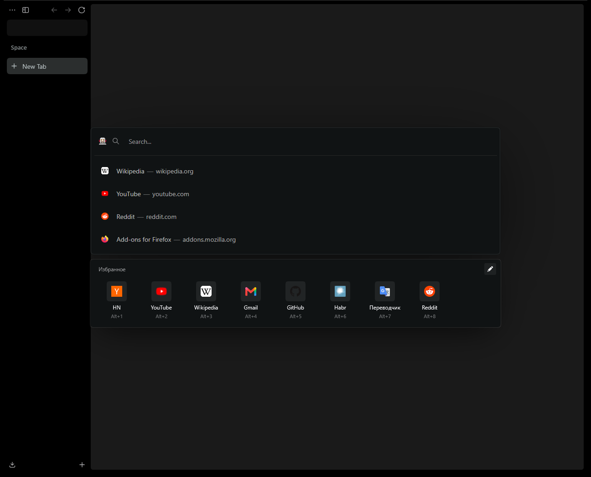

# Zen: New Tab Favorites

A mod for [Zen Browser](https://zen-browser.app/) that adds a favorites panel below the floating address bar opened with Ctrl+T. The bar also gets wider (900px instead of 750px) and moves up, so the bar and the panel together sit in the center of the window.



## Usage

- **Ctrl+T** opens the bar, and the panel appears below it. Ctrl+L on a regular page does not show the panel.
- **Clicking a tile** opens the site, just as if you had typed its address into the bar.
- **Alt+1…Alt+9** open sites by their number straight from the bar. Works with any keyboard layout.
- **Middle click** opens the site in a background tab and keeps the bar open.
- **The pencil** in the panel header toggles edit mode:
  - drag a tile to reorder it;
  - click a tile to open a form where you can change its name and address; Enter saves, Escape cancels;
  - the cross removes a site;
  - the "Добавить" (Add) tile opens a form for a new site. The address can be short (`github.com`), and if the name is left empty, the domain is used.

## Where the list is stored

In a regular bookmarks folder named **"Избранное новой вкладки"** ("New Tab Favorites") inside "Other Bookmarks". This means:

- the list syncs between devices through your Mozilla account if bookmark sync is enabled;
- you can also edit it in the Library window (Ctrl+Shift+O), and the panel picks up changes immediately.

Icons come from the browser history. If a site has never been visited, its icon is loaded from the site itself (`/favicon.ico`), and if there is none, the first letter of the name is shown.

## Settings

In `about:config`:

| Preference | Default | What it does |
|---|---|---|
| `zenFavorites.urlbarWidth` | `900` | Maximum width of the floating bar in pixels (capped at 90% of the window width). `0` keeps Zen's width. Applies immediately, no restart needed. |
| `zenFavorites.folderGuid` | — | Internal: which bookmarks folder is used. |

## Installation

The mod requires [fx-autoconfig](https://github.com/MrOtherGuy/fx-autoconfig): Zen Mods only support CSS, and the panel needs JavaScript. The loader is already included in `vendor/`, and the installer sets it up for you.

The installation is permanent: files are copied into the profile, and the mod loads every time Zen starts. The project folder is not needed after installation; you only need it to update the mod.

### Windows

1. Close Zen completely.
2. In the project folder, run:

   ```powershell
   powershell -ExecutionPolicy Bypass -File .\install.ps1
   ```

   The installer:
   - puts `config.js` into the Zen folder (`C:\Program Files\Zen Browser`) if it is not there yet. This requires administrator rights, so a UAC prompt will appear;
   - copies the mod files into the `chrome\` folder of the profile Zen opens by default. A different profile can be specified with `-ProfilePath "<path>"`;
   - clears the startup cache so Zen picks up the new scripts.
3. Start Zen and press Ctrl+T.

### Linux

1. Close Zen completely.
2. In the project folder, run:

   ```bash
   ./install.sh
   ```

   The script finds Zen and the profile automatically for these installation types:

   | Installation | Zen folder | Profiles |
   |---|---|---|
   | Script from the Zen website (tarball) | `~/.tarball-installations/zen` | `~/.zen` or `~/.config/zen` |
   | AUR and other packages | `/opt/zen-browser-bin`, `/opt/zen-browser`, `/usr/lib/zen-browser`, etc. | `~/.zen` or `~/.config/zen` |
   | Flatpak | `…/flatpak/app/app.zen_browser.zen/current/active/files/zen` | `~/.var/app/app.zen_browser.zen/.zen` |

   If the Zen folder is not writable (e.g. `/opt`), `config.js` is copied with `sudo`. Other paths can be specified explicitly:

   ```bash
   ./install.sh --zen-dir /path/to/zen --profile "/path/to/profile"
   ```

3. Start Zen and press Ctrl+T.

Linux limitations:

- **Flatpak.** The app folder is read-only and is replaced on every Zen update. That is why `config.js` is installed with `sudo`, and `./install.sh` has to be run again after every Flatpak update. The mod itself stays in the profile.
- **AppImage.** The image is read-only. Extract it (`./zen.AppImage --appimage-extract`) and pass `--zen-dir squashfs-root`, or install Zen with the script from the website.
- **Alt+1…9.** On Linux, Firefox uses these shortcuts to switch tabs. While the panel is open, the mod intercepts them; the rest of the time they work as usual.

### General

`config.js` loads scripts only from profiles that contain `chrome/utils/chrome.manifest`; other profiles are not affected.

To update the mod, just close Zen again and rerun the installer.

### If Zen updated and the mod is gone

A regular Zen update does not remove `config.js`, but reinstalling Zen may (and Flatpak removes it on every update). In that case, run the installer again.

If a new Zen version changes how the address bar works and the panel misbehaves, you can temporarily disable the scripts: `about:config` → `userChromeJS.enabled` = `false`, then restart Zen.

## Uninstallation

1. Close Zen.
2. Delete from `<profile>\chrome\`:
   - `JS\zen-newtab-favorites.uc.js`
   - `CSS\zen-newtab-favorites.uc.css`
   - `resources\zen-newtab-favorites\`
3. If you don't need other fx-autoconfig scripts, also delete `chrome\utils\`, and from the Zen folder, `config.js` and `defaults\pref\config-prefs.js`.

The bookmarks folder stays. You can delete it manually in the Library window.

## How it works

```
src/
  JS/zen-newtab-favorites.uc.js                  panel: markup, events, drag and drop, Alt+N
  CSS/zen-newtab-favorites.uc.css                styles for the panel and the wider bar
  resources/zen-newtab-favorites/store.sys.mjs   bookmark storage, a shared module for all windows
vendor/fx-autoconfig/                            script loader (MPL-2.0)
install.ps1, install.sh                          installers (Windows, Linux)
tools/                                           development and testing
```

The panel is inserted inside the `#urlbar` element. Zen treats clicks inside it as clicks on the bar itself and does not close it. The panel is shown when the bar has the `zen-newtab`, `zen-floating-urlbar="true"` and `breakout-extend` attributes at the same time, i.e. in new tab mode.

While the edit form is open, the mod intercepts the address bar's `blur`. Otherwise the bar would close when focus moves into a form field.

## Development

Debugging uses a separate Zen instance with a temporary profile in `.dev\profile`, so your main profile is left untouched. It is controlled through Marionette.

```powershell
.\tools\dev.ps1 -Fresh          # install the mod into the test profile and start Zen with Marionette
.\tools\test.ps1 seed           # fill in a test list
.\tools\test.ps1 edit -Shot     # scenarios: edit, drag, open, misc; screenshot in .dev\
node .\tools\marionette.mjs eval "return gZenFavoritesPanel.items"   # run JS in the browser window
.\tools\shot.ps1 -Out .dev\s.png                                      # screenshot of the test Zen window
```

The scenarios in `tools\tests` generate real (trusted) mouse and keyboard events via `window.synthesizeMouseEvent` and `nsITextInputProcessor`, so focus and bar closing behave the same as with manual use.

On Linux, `tools/dev.sh` and `tools/test.sh` do the same. The Zen path is taken from `$ZEN_BIN` or `zen` in `PATH`. There is no screenshot tool for Linux; use any system tool.

The Linux installer is tested without a real Zen, on fake layouts in a temporary folder:

```bash
bash tools/tests/install-linux.sh
```

The mod has been tested on Zen 1.22.3b (Firefox 156) on Windows. The Linux installer has been tested on fake layouts (tarball, XDG, Flatpak, sudo) in WSL; the mod itself has not yet been run in a live Zen on Linux.
